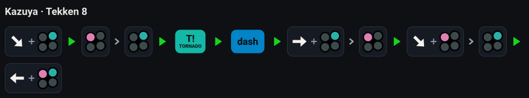
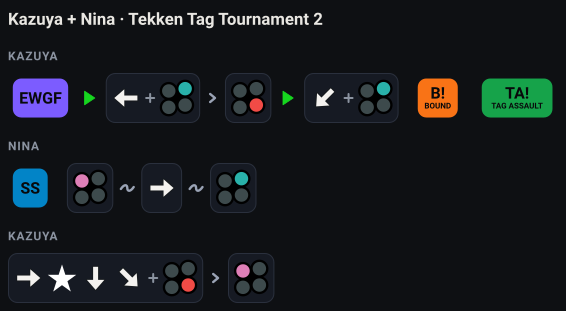
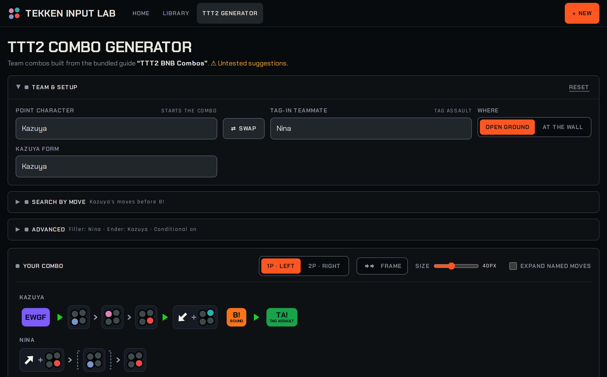

<h1 align="center">Tekken Input Lab</h1>
<p align="center">Turn Tekken combo notation into arcade command graphics, and keep your own combo library.</p>
<p align="center">
  
</p>
<p align="center">
  
  
  
  
</p>

Tekken Input Lab reads combo notation and draws every direction, button press, transition and combo event the way an arcade stick shows it: white arrows, and a 2×2 button cluster with each pressed button in its in-game color. It supports **Tekken 6**, **Tekken Tag Tournament 2**, **Tekken 7** and **Tekken 8**.

It runs entirely in the browser. Combos are stored locally in IndexedDB, with no account and no server.

## From notation to commands

Type this:

```text
df+2 > 1,2 > T! > dash > f+2,1 > df+1,2 > b+1+2
```

And get this, live as you type, and exportable as SVG or PNG:



Tag Tournament 2 team combos get one row per character, with `B!` and the Tag Assault marked:

```text
Kazuya:
EWGF > b+2,4 > db+2 B! TA!
Nina:
ss+1~f~2
Kazuya:
cd+4,1
```



## Screenshots


<details>
<summary><strong>TTT2 combo generator</strong></summary>
<br>

</details>

## Features

- **Live visualizer:** simultaneous inputs (`1+2`) share one cluster, and sequential inputs (`df+1,2`) get one each. The drawing wraps to the screen width, has an adjustable size, and can mirror the arrows for the 2P side.
- **Named moves:** `EWGF`, `DU`, `HS` and others are drawn as labels. Click one to see its input, or turn on **Expand named moves** to show them all.
- **Game-aware validation:** a mechanic that does not exist in the selected game gets a warning, such as `S!` in Tekken 8 or the TAG button outside TTT2. Notation is never silently reinterpreted.
- **TTT2 combo generator:** builds team combos from the bundled "TTT2 BNB Combos" guide, one phase at a time: a route to `B!`, the Tag Assault filler, then the ender.
- **Combo library:** create, edit and duplicate combos, then search and filter by game, character, partner, difficulty, tags and favorites.
- **Export and backup:** save any combo as SVG or PNG, and back up or restore the whole library as versioned JSON.

## Getting started

You need Node.js 22 or later.

```sh
npm install
npm start
```

Then open `http://localhost:5173`.

> [!NOTE]
> The library lives in your browser's IndexedDB. Clearing site data deletes it, so use **Export JSON** in the library first.

<details>
<summary><strong>Tests and build</strong></summary>

```sh
npm test            # unit tests (Vitest)
npm run typecheck
npm run coverage    # coverage report, 80% line minimum on the engine and storage
npm run e2e         # Playwright browser tests, desktop and mobile
npm run build       # type check and production build to dist/
```

</details>

## Notation

The basics:

| Symbol | Meaning | Example |
|---|---|---|
| `+` | pressed together | `df+1`, `1+2` |
| `,` | next input | `df+1,2` |
| `~` | immediately | `1~b~uf+4` |
| `:` | just frame | `f,n,d,df:2` |
| `>` | next combo stage | `df+2 > 1,2 > T!` |
| `B!` `T!` `W!` … | combo events | `db+2 B!` |

The full reference covers motions, prefixes, events by game, mechanics and dialects: [`docs/NOTATION.md`](docs/NOTATION.md).

## TTT2 combo generator

The generator joins three pieces at the Tag Assault: the point character's route up to `B!`, a filler from the partner's TA! list, and an ender. You pick the team, open ground or the wall, and who performs each part. Pieces that break the guide's rules are left out, and conditions such as hit counts or opponent size are flagged so you know what to check.

Its sources ship as plain text in `src/data/ttt2/`: the guide, and the TTT2 move lists as wikitext. To rebuild `movelists.json` from the wikitext, run:

```sh
node scripts/ttt2/parseMovelists.mjs
```

How it works: [`docs/TTT2_TEAM_COMBOS.md`](docs/TTT2_TEAM_COMBOS.md). Abbreviations used by the guide: [`docs/TTT2_ABBREVIATIONS.md`](docs/TTT2_ABBREVIATIONS.md).

> [!IMPORTANT]
> The guide states that its routes were not independently tested. Treat every generated combo as a suggestion until you try it in practice mode.

## Project layout

```text
src/notation/    Lexicon, mechanics, dialects, games and character dictionaries
src/parser/      Tokenizer, recursive-descent parser and semantic validation
src/render/      Pure layout engine (AST to positioned boxes) and theme
src/components/  Arcade SVG components and shared UI
src/features/    Library, editor, details, generator and export screens
src/storage/     Dexie database, ComboRepository, zod schemas, JSON backup
src/ttt2/        Guide importer, move lists and combo generator
src/data/ttt2/   Bundled guide and move list sources
scripts/ttt2/    Move list parser
tests/, e2e/     Vitest unit tests and Playwright browser tests
```

The parser and the renderer are independent:

- **Parser:** `parseNotation(text, { game, dialect, characters })` returns tokens with spans into the original text, the AST, normalized text and diagnostics. It never throws.
- **Renderer:** `layoutCombo()` is a pure function. The same SVG is drawn on screen and in exports, so exported images match the screen exactly.

## Stack

| Area | Tools |
|---|---|
| App | React 19, TypeScript and Vite |
| Styling | Tailwind CSS 4, with Chakra Petch and Rajdhani from Fontsource |
| Storage and validation | Dexie for IndexedDB, zod for validation |
| Tests | Vitest and Testing Library for unit tests, Playwright for browser tests |

## Credits

- The visual approach was inspired by [T8 Notation Maker](https://github.com/LinSDK/t8-notation-maker). That repository has no license, so no code or assets were reused. All icons here are original SVG components.
- The "TTT2 BNB Combos" guide was compiled from Tekken Zaibatsu, YouTube and community contributors.
- TTT2 move lists come from [Tekken Wiki](https://tekken.fandom.com/) on Fandom, licensed under CC BY-SA.
- The code is released under the [MIT License](LICENSE). The bundled guide and move lists keep their original authors and terms.
