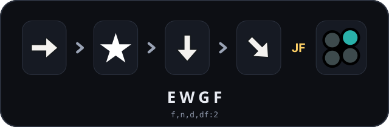
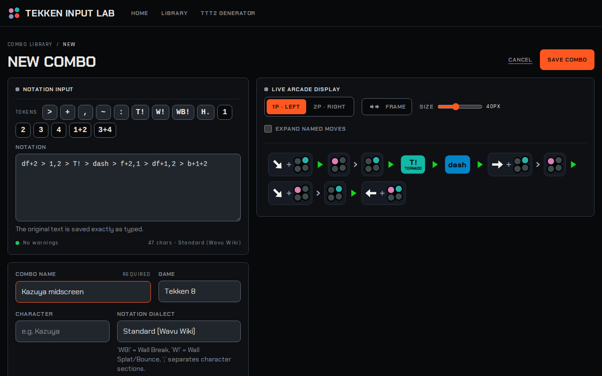

<h1 align="center">Tekken Input Lab</h1>
<p align="center">
  
</p>
<p align="center">Turn Tekken combo notation into arcade command graphics, and keep your own combo library.</p>

Tekken Input Lab reads notation such as `qcf+1 > uf+2,1 B! > SSL 1~b~uf+4` and draws every direction, button press, transition and combo event the way an arcade stick shows it: white arrows, and a 2×2 button cluster with each pressed button in its in-game color. It supports **Tekken 6**, **Tekken Tag Tournament 2**, **Tekken 7** and **Tekken 8**.

It runs entirely in the browser. Combos are stored locally in IndexedDB, with no account and no server.

<p align="center">
  
  
</p>

## Features

- **Live visualizer:** Simultaneous inputs (`1+2`) share one cluster, and sequential inputs (`df+1,2`) get one each. The drawing wraps to the screen width, has adjustable size, and can mirror arrows for the 2P side.
- **Named moves:** `EWGF`, `DU`, `HS` and other named moves are shown as labels. Click one to see its input, or turn on **Expand named moves** to open them all.
- **Game-aware validation:** A mechanic that does not exist in the selected game produces a warning (`S!` in Tekken 8, `RD` outside Tekken 7, the TAG button outside TTT2). Notation is never silently reinterpreted.
- **TTT2 team combos:** Pick a main character and a partner, then assign each section of the combo to one of them. `Name:` labels in the notation are recognized.
- **TTT2 combo generator:** Builds team combos from the bundled "TTT2 BNB Combos" guide and the TTT2 move lists: a route to `B!`, then `TA!`, a filler and an ender. You choose the team, open ground or wall, the starter (normal, Counter Hit or Low Parry) and who does each part.
- **Combo library:** Create, edit, duplicate and delete combos, then search and filter by game, character, partner, difficulty, tags and favorites.
- **Export:** Save a combo as SVG or PNG, and back up or restore the whole library as versioned JSON.

## Requirements

Node.js 22 or later, and npm.

## Quick start

```sh
npm install
npm start
```

Open `http://localhost:5173`.

Checks:

```sh
npm test            # unit tests (Vitest)
npm run typecheck
npm run coverage    # coverage report, 80% line minimum on the engine and storage
npm run e2e         # Playwright browser tests, desktop and mobile
npm run build       # type check and production build to dist/
```

> [!NOTE]
> The library lives in your browser's IndexedDB. Clearing site data deletes it, so use **Export JSON** in the library before you do.

## Notation

| Symbol | Meaning | Example |
|---|---|---|
| `+` | pressed together | `df+1`, `1+2` |
| `,` | next input | `df+1,2` |
| `~` | immediately | `1~b~uf+4` |
| `:` | just frame | `f,n,d,df:2` |
| `<` | delayed | `df+3,2,<1` |
| `*` | hold (uppercase directions are held too) | `df+1*`, `F+2` |
| `>` | next combo stage | `df+2 > 1,2 > T!` |
| `;` | section break, or Tag Assault in the TTT2 dialect | `… ; 3+4,2` |
| `[ ]` | optional part | `df+2 [dash] f+2` |
| `( )` | optional input, or a note when it is not notation | `(1,2),2`, `1,2 (wall)` |
| `x3` | repeat | `b+1 x3` |
| `5` | TAG button (TTT2) | `df+1,2~5` |

The parser also accepts `d/f` style directions, arrows (`→ ↘`), and `df1` for `df+1`. Motions are `qcf qcb hcf hcb cd ff bb fff`. State prefixes are `WS FC BT WR CH iWS` and `H.` (Heat). Movements are `dash SSL SSR SS SW BD WD CC micro`.

### Combo events by game

| Event | Meaning | T6 | TTT2 | T7 | T8 |
|---|---|---|---|---|---|
| `B!` | Bound | ✓ | ✓ | ⚠ not an extender | ⚠ only after airborne Heat Burst |
| `S!` | Screw / Tailspin | ✗ | ✗ | ✓ | ✗ |
| `T!` | Tornado | ✗ | ✗ | ✗ | ✓ |
| `W!` | Wall Splat | ✓ | ✓ | ✓ | ✓ |
| `WB!` | Wall Break (default dialect) | ✓ | ✓ | ✓ | ✓ |
| `F!` / `FB!` | Floor Break | ✓ | ✓ | ✓ | ✓ |
| `BB!` | Balcony Break | ✗ | ✓ | ✓ | ✓ |
| `WBl!` / `FBl!` | Wall / Floor Blast | ✗ | ✗ | ✗ | ✓ |
| `WBo!` | Wall Bound | character-specific | ✗ | Season 2+ | ✓ |
| `TA!` | Tag Assault | ✗ | ✓ | ✗ | ✗ |

Mechanic keywords: `RA` (Rage Art: T7, T8), `RD` (Rage Drive: T7), and `HB HS HD HE` (Heat Burst, Heat Smash, Heat Dash, Heat Engager: T8). The juggle extender (`B!`, `S!` or `T!`) is allowed once per combo.

> [!TIP]
> Community notation is not uniform. Ambiguous symbols such as `;` and `WB!` follow the **dialect** chosen in the editor: Standard ([Wavu Wiki](https://wavu.wiki/t/Notation)), TTT2 Combo ([kagewebsite](https://ttt2combo.kagewebsite.com/)), where `;` means Tag Assault, or Community, where `WB!` means Wall Bound.

## TTT2 data

The generator ships its sources as plain text in `src/data/ttt2/`, and they stay the source of truth:

- **`ttt2-bnb-combos.md`** is the "TTT2 BNB Combos" guide, converted on first use by `src/ttt2/guideImporter.ts`. Lines the importer cannot classify are reported, never guessed.
- **`movelists-src/`** holds the TTT2 move lists as wikitext. Rebuild `movelists.json` from them with:

```sh
node scripts/ttt2/parseMovelists.mjs
```

Generator rules are in [`docs/TTT2_TEAM_COMBOS.md`](docs/TTT2_TEAM_COMBOS.md), and the abbreviations used by the guide are in [`docs/TTT2_ABBREVIATIONS.md`](docs/TTT2_ABBREVIATIONS.md).

> [!IMPORTANT]
> The guide states that its routes were not independently tested. Each generated combo is a suggestion until you try it in practice mode.

## Project layout

```text
src/notation/    Lexicon, mechanics, dialects, games and character dictionaries
src/parser/      Tokenizer, recursive-descent parser and semantic validation
src/render/      Pure layout engine (AST to positioned boxes) and theme
src/components/  Arcade SVG components and shared UI
src/features/    Library, editor, details, generator and export screens
src/storage/     Dexie database, ComboRepository, zod schemas, JSON backup
src/ttt2/        Guide importer, move lists and combo generator
src/data/ttt2/   Bundled guide and move list sources
scripts/ttt2/    Move list parser
tests/, e2e/     Vitest unit tests and Playwright browser tests
```

`parseNotation(text, { game, dialect, characters })` returns tokens with spans into the original text, the AST, normalized text and diagnostics, and never throws. `layoutCombo()` is a pure function, and the same SVG is used on screen and in exports, so exported images match the screen.

## Stack

React 19, TypeScript and Vite, styled with Tailwind CSS 4. Dexie for IndexedDB storage, zod for validation, and Chakra Petch and Rajdhani from Fontsource. Vitest and Testing Library for unit tests, Playwright for browser tests.

## Credits

- The visual approach was inspired by [T8 Notation Maker](https://github.com/LinSDK/t8-notation-maker). That repository has no license, so no code or assets were reused. All icons here are original SVG components.
- The "TTT2 BNB Combos" guide was compiled from Tekken Zaibatsu, YouTube and community contributors.
- TTT2 move lists come from [Tekken Wiki](https://tekken.fandom.com/) on Fandom, licensed under CC BY-SA.
- The code is released under the [MIT License](LICENSE). The bundled guide and move lists keep their original authors and terms.
